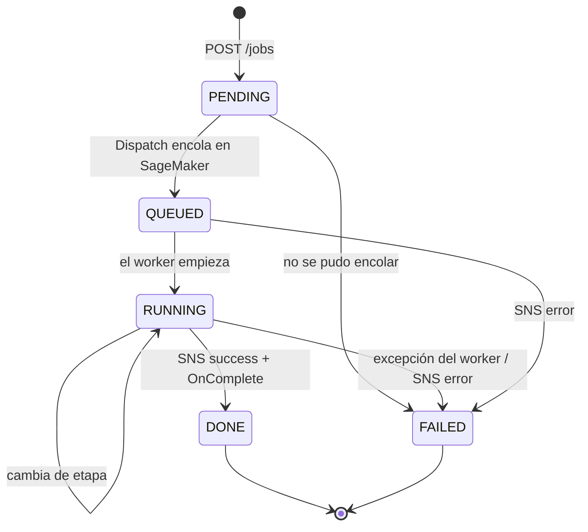

# Contrato HTTP

API anónima y pública (HTTP API de API Gateway + Lambdas), con CORS `*`. La misma API corre en local
con `npm run local:api` (`src/scripts/local_api.py`, Flask, un job a la vez). El contrato vive en código
en `src/contract/jobs.py` y es la única fuente de verdad: lo comparten las Lambdas, el worker y la API
local. Los tipos del frontend (`web/src/api/types.ts`) lo reflejan.

- [Resumen de endpoints](#resumen-de-endpoints)
- [Ciclo de vida de un job](#ciclo-de-vida-de-un-job)
- [GET /instruments](#get-instruments)
- [POST /jobs](#post-jobs)
- [Subida del audio](#subida-del-audio)
- [GET /jobs/{jobId}](#get-jobsjobid)
- [Errores](#errores)
- [Límites y protecciones](#límites-y-protecciones)
- [Ejemplo con curl](#ejemplo-con-curl)

---

## Resumen de endpoints

| Método | Ruta            | Lambda            | Qué hace                                                       |
| ------ | --------------- | ----------------- | -------------------------------------------------------------- |
| GET    | `/instruments`  | `ListInstruments` | Catálogo de instrumentos, modos, valores por defecto y límites |
| POST   | `/jobs`         | `CreateJob`       | Valida, cuenta cuota, crea el job y devuelve un POST prefirmado |
| GET    | `/jobs/{jobId}` | `GetJob`          | Estado, etapas y, si terminó, URLs prefirmadas de los resultados |

Además, dos Lambdas no expuestas por HTTP: `Dispatch` (evento de S3) y `OnComplete` (notificación de SNS).

---

## Ciclo de vida de un job



| Estado    | Significado                                                                                  |
| --------- | -------------------------------------------------------------------------------------------- |
| `PENDING` | Job creado, esperando que el navegador suba el audio                                         |
| `QUEUED`  | Audio recibido y petición encolada en el endpoint asíncrono (puede esperar un arranque en frío) |
| `RUNNING` | El worker lo procesa; `stage` indica la etapa actual                                         |
| `DONE`    | Terminó; `result` trae las URLs                                                              |
| `FAILED`  | Falló; `error` trae el motivo                                                                |

Las transiciones de `Dispatch` y `OnComplete` son **condicionales** (`expected_statuses` en
`services/dynamodb.update_job`): solo actualizan si el job sigue en un estado abierto. Así son
idempotentes, no pisan un `DONE` y toleran el orden de llegada de los eventos (p. ej. el worker pasa a
`RUNNING` antes de que `Dispatch` escriba `QUEUED`: esa escritura simplemente no se aplica).

Etapas (`stage`, `stages`): `separation`, `transcription`, `engraving`, `export`.

---

## GET /instruments

Catálogo para construir la interfaz. Se cachea una hora (`Cache-Control: public, max-age=3600`).

```jsonc
{
  "instruments": [
    {
      "id": "clarinet", "name": "Clarinete en Si♭", "family": "woodwinds",
      "modes": ["orchestra"], "clef": "treble", "transposition": "M-2",
      "range": ["D3", "A#6"], "monophonic": true
    }
  ],
  "families": [{ "id": "woodwinds", "name": "Maderas" }],
  "modes": [{ "id": "auto", "name": "Automático" }, { "id": "rock", "name": "Rock / banda" },
            { "id": "orchestra", "name": "Orquesta" }],
  "defaults": { "rock": ["vocals", "guitar", "bass", "piano", "drums"], "orchestra": ["flute", "…"] },
  "limits": { "maxDurationSec": 90, "maxUploadBytes": 26214400,
              "contentTypes": ["audio/wav", "audio/x-wav", "audio/wave", "audio/mpeg",
                               "audio/flac", "audio/ogg", "audio/mp4"] },
  "quantizations": ["1/8", "1/16", "1/32"]
}
```

`transposition` es el intervalo de music21 de altura escrita a sonora (`"M-2"`: suena una 2.ª mayor por
debajo de lo escrito). `range` es el rango sonoro en notación científica.

---

## POST /jobs

Crea un job. **No recibe el audio**: devuelve un POST prefirmado para subirlo directamente a S3.

Petición:

```jsonc
{
  "mode": "rock",                    // auto (defecto) | rock | orchestra
  "instruments": ["vocals", "bass"], // opcional; por defecto, los del modo
  "options": {                       // opcional; cada clave tiene valor por defecto
    "quantization": "1/16",          // 1/8 | 1/16 | 1/32
    "allowTriplets": false,
    "exportPdf": true
  },
  "fileName": "demo.wav",
  "contentType": "audio/wav",
  "sizeBytes": 3528044,
  "durationSec": 20
}
```

Validación (`validate_create_request`):

| Campo         | Regla                                                                                           |
| ------------- | ----------------------------------------------------------------------------------------------- |
| `mode`        | uno de `auto`, `rock`, `orchestra`                                                              |
| `contentType` | uno de los listados en `limits.contentTypes` (se ignora lo que sigue a `;`)                     |
| `sizeBytes`   | entero positivo, $\le 25\ \text{MB}$                                                            |
| `durationSec` | número positivo, $\le 90{,}5$ s (el audio se recorta a 90 s en el worker)                       |
| `instruments` | ids conocidos; con `mode` fijo, deben existir en ese modo; con `auto` se aceptan todos          |
| `options`     | solo las claves `quantization`, `allowTriplets`, `exportPdf`, con sus tipos                     |
| `fileName`    | texto, máx. 200 caracteres (por defecto `audio`)                                                |

Con `mode=auto` los instrumentos se filtran en el worker cuando ya se conoce la ruta
(`instruments_for_route`).

Respuesta `201`:

```json
{
  "jobId": "5f0e3a4e-…-uuid",
  "status": "PENDING",
  "upload": {
    "url": "https://<bucket>.s3.us-east-1.amazonaws.com/",
    "fields": { "Content-Type": "audio/wav", "key": "uploads/<jobId>.wav", "policy": "…", "x-amz-signature": "…" }
  },
  "expiresInSec": 600
}
```

Efectos: consume una unidad de la cuota diaria del llamante, guarda `JOB#<jobId>` en DynamoDB en estado
`PENDING` con un TTL de 24 h y genera el POST prefirmado.

---

## Subida del audio

El cliente sube el archivo **directamente a S3** con el POST prefirmado, como `multipart/form-data`:
todos los `fields` en el mismo orden y, **al final**, el campo `file` (S3 ignora lo que va después).

```bash
curl -s "$URL" -F key=… -F Content-Type=… -F policy=… … -F file=@demo.wav
```

La política del POST obliga a que `Content-Type` coincida y a que el tamaño esté entre 1 byte y 25 MB
(`content-length-range`). Caduca a los 600 s (`UPLOAD_EXPIRES_SEC`). Responde `204` si va bien.

Al terminar la subida, S3 emite `ObjectCreated` sobre `uploads/` y la Lambda `Dispatch` toma el relevo:
el cliente no necesita avisar de nada.

---

## GET /jobs/{jobId}

Estado del job. Cada resultado es una **URL prefirmada de S3** válida 1 h
(`URL_EXPIRES_SEC`, con `Content-Disposition: attachment`).

```jsonc
{
  "jobId": "…", "status": "DONE", "mode": "auto", "resolvedMode": "rock",
  "instruments": ["vocals", "guitar", "bass", "piano", "drums"],
  "options": { "quantization": "1/16", "allowTriplets": false, "exportPdf": true },
  "createdAt": "2026-10-24T15:04:05Z", "updatedAt": "…", "expiresAt": "…",
  "stage": null,
  "stages": { "separation": 41.2, "transcription": 12.8, "engraving": 3.1, "export": 9.6 },
  "warnings": ["Partitura aproximada: …"],
  "error": null,
  "result": {                          // solo si status == DONE
    "durationSec": 20.0, "tempo": 120.0, "timeSignature": "4/4", "key": "A minor",
    "stems": [{ "name": "vocals", "label": "Voz", "url": "https://…" }],
    "midi":  [{ "instrument": "bass", "name": "Bajo eléctrico", "url": "https://…", "notes": 64 }],
    "midiFull": "https://…",
    "score": { "musicxml": "https://…", "pdf": "https://…" },
    "parts": [{ "instrument": "bass", "name": "Bajo eléctrico", "url": "https://…" }]
  }
}
```

Mientras no esté `DONE`, `result` es `null`. `score.pdf` es `null` si no se pidió o no pudo generarse.
`stems` está vacío en la ruta orquesta. Las fechas son ISO 8601 en UTC.

La SPA consulta este endpoint cada 3 s hasta que el estado sea `DONE` o `FAILED`; ante errores
transitorios sigue consultando y solo se detiene con un `404`.

---

## Errores

Cuerpo siempre `{"message": "<texto>"}`:

| Código | Cuándo                                                                                |
| ------ | ------------------------------------------------------------------------------------- |
| `400`  | JSON inválido o campo que incumple las reglas de validación                           |
| `404`  | `jobId` no es un UUID, no existe o ya expiró (24 h)                                   |
| `429`  | cuota diaria por IP agotada, o _throttling_ de la API (5 rps, ráfaga de 10)           |
| `5xx`  | error inesperado en una Lambda                                                        |

---

## Límites y protecciones

La API es anónima; el costo de la GPU se protege con tres capas:

| Capa                 | Detalle                                                                                              |
| -------------------- | ---------------------------------------------------------------------------------------------------- |
| _Throttling_         | 5 peticiones/s, ráfaga 10, en la etapa por defecto de API Gateway                                    |
| Cuota por IP y día   | `dev` 50, `test` 20, `prod` 10 jobs. La IP se guarda **con hash** (SHA-256, 32 hex): `QUOTA#<hash>#<fecha>`; el contador es atómico y expira a las 48 h |
| Límites de entrada   | 90 s de duración, 25 MB, tipos de contenido de la lista                                              |

Privacidad: el audio y los resultados se borran del bucket al día (_lifecycle_ de 1 día; S3 lo ejecuta
una vez al día, así que pueden vivir hasta ~48 h), y los jobs de DynamoDB expiran a las 24 h. No hay
galería ni almacenamiento a largo plazo.

---

## Ejemplo con curl

```bash
API=$(aws ssm get-parameter --name /audio2score-api/ApiUrl --query Parameter.Value --output text)

# 1. Crear el job
JOB=$(curl -s -X POST "$API/jobs" -H 'Content-Type: application/json' \
  -d '{"mode":"rock","fileName":"demo.wav","contentType":"audio/wav","sizeBytes":'$(stat -c%s data/audio/demo_rock.wav)',"durationSec":20}')

# 2. Subir el audio con el POST prefirmado
echo "$JOB" | jq -r '.upload.fields | to_entries[] | "-F \(.key)=\(.value)"' \
  | xargs curl -s "$(echo "$JOB" | jq -r .upload.url)" -F file=@data/audio/demo_rock.wav

# 3. Consultar el estado
curl -s "$API/jobs/$(echo "$JOB" | jq -r .jobId)" | jq '{status, stage, stages}'
```
