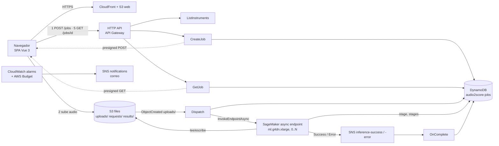
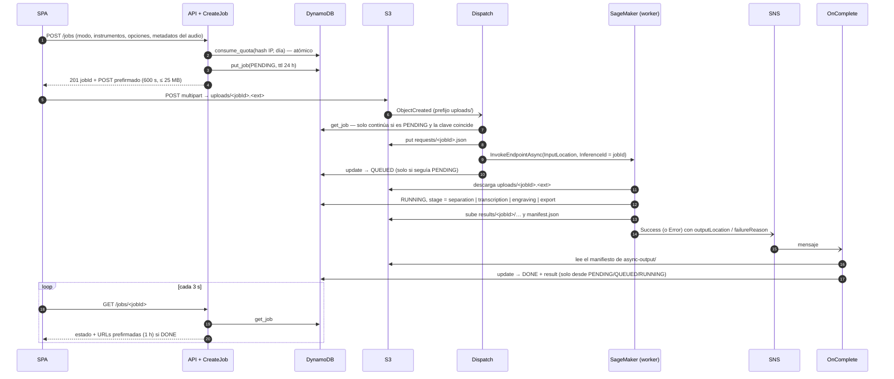
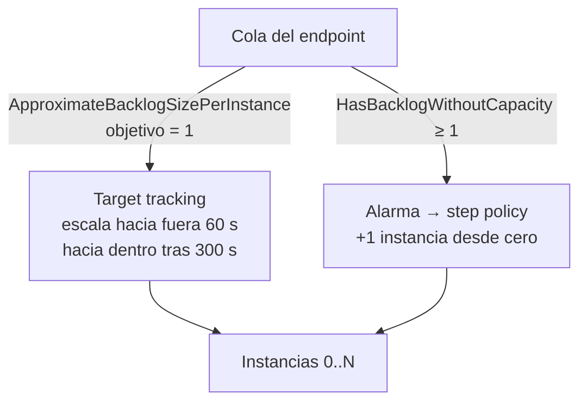

# Arquitectura en AWS e interacciones entre servicios

Cómo se conectan el frontend, la API, el almacenamiento y el worker GPU. El diagrama editable está en
[`architecture.drawio`](architecture.drawio). Estado: **implementado, nunca desplegado**; los tiempos y
costos de este documento son los del IaC o estimaciones, no mediciones.

- [Vista general](#vista-general)
- [Los cinco stacks](#los-cinco-stacks)
- [Flujo de una petición](#flujo-de-una-petición)
- [Estado y datos](#estado-y-datos)
- [Worker GPU y autoescalado](#worker-gpu-y-autoescalado)
- [Frontend](#frontend)
- [Seguridad y privacidad](#seguridad-y-privacidad)
- [Alarmas y costos](#alarmas-y-costos)
- [Desarrollo local](#desarrollo-local)

---

## Vista general



---

## Los cinco stacks

Un servicio de Serverless Framework v4 por carpeta de `serverless/`, con `stackName: audio2score-<servicio>`.
Los valores entre stacks viajan por **SSM Parameter Store** (`/audio2score-<servicio>/<Nombre>`), no por
referencias directas, de modo que cada stack se despliega por separado.

| Stack     | Recursos                                                                                                   | Publica en SSM                                                       |
| --------- | ---------------------------------------------------------------------------------------------------------- | -------------------------------------------------------------------- |
| `storage` | Bucket de archivos, tabla DynamoDB, 3 topics SNS (éxito, error, notificaciones), presupuesto mensual       | `FilesBucketName`, `JobsTableName/Arn`, ARNs de los topics            |
| `image`   | Repositorio ECR (se conserva al borrar el stack)                                                           | `RepositoryName/Arn/Uri`                                             |
| `worker`  | Modelo, configuración y endpoint asíncrono de SageMaker, autoescalado 0..N, alarmas, roles IAM             | `EndpointName`, `DeployedImageTag`                                   |
| `api`     | HTTP API y las 5 Lambdas (Python 3.13, arm64), roles IAM por función                                       | `ApiUrl`                                                             |
| `web`     | Bucket privado + CloudFront con OAC, política de cabeceras de seguridad                                    | `WebUrl`                                                             |

Orden de despliegue: `storage → image → image:push → worker → api → web`. `worker` falla si la imagen
con la etiqueta de `container/image-version.js` (hash del contenido) no está en ECR.

---

## Flujo de una petición



Puntos de diseño:

- **El audio nunca pasa por la API.** El navegador sube directo a S3; la API solo emite la autorización.
  Esto evita los límites de tamaño de API Gateway/Lambda.
- **El cliente no avisa del fin de la subida.** Lo detecta S3 (evento sobre `uploads/`); `Dispatch` es
  **idempotente** (solo despacha jobs `PENDING` cuya `inputKey` coincide) y tiene un reintento.
- **Cola dentro de SageMaker.** El endpoint asíncrono encola las peticiones; `InferenceId = jobId` permite
  correlacionar la notificación de SNS con el job sin estado adicional.
- **Dos vías de salida:** el worker devuelve el manifiesto (SageMaker lo guarda en `async-output/`) y
  `OnComplete` lo copia al job; si el worker falla, SageMaker publica en el topic de error y `OnComplete`
  marca `FAILED`, conservando el mensaje propio del worker si ya lo había escrito.
- **Fallo al encolar:** si `InvokeEndpointAsync` lanza una excepción, `Dispatch` marca el job `FAILED`.

---

## Estado y datos

### Tabla `audio2score-jobs` (DynamoDB, bajo demanda, TTL en `ttl`)

Una sola clave `pk` (string), dos tipos de elemento:

| `pk`                      | Contenido                                                                                                           |
| ------------------------- | ------------------------------------------------------------------------------------------------------------------- |
| `JOB#<jobId>`             | `status`, `mode`, `resolvedMode`, `instruments`, `options`, `fileName`, `contentType`, `sizeBytes`, `durationSec`, `inputKey`, `stage`, `stages`, `warnings`, `error`, `result`, `outputLocation`, `createdAt`, `updatedAt`, `expiresAt`, `ttl` |
| `QUOTA#<hashIP>#<fecha>`  | `count` (contador atómico) y `ttl` (48 h)                                                                           |

- Los `float` se guardan como `Decimal` (`to_dynamo`) y se devuelven como `int`/`float` (`from_dynamo`).
- `put_job` usa `attribute_not_exists(pk)`: no sobrescribe un job existente.
- `update_job` asigna campos (los `None` se eliminan) y puede exigir un estado previo con
  `Attr("status").is_in(...)`. Usa los marcadores `#u*`/`:u*` porque el constructor de condiciones de boto3
  genera `#n0/:v0` y los pisaría.
- DynamoDB tarda horas en borrar por TTL, así que `GetJob` compara además `ttl` con la hora actual.

### Bucket de archivos (S3)

| Prefijo            | Quién escribe | Contenido                                           |
| ------------------ | ------------- | --------------------------------------------------- |
| `uploads/`         | navegador     | audio original (`<jobId>.<ext>`); dispara `Dispatch` |
| `requests/`        | `Dispatch`    | petición al worker (`jobs.worker_request`)          |
| `results/<jobId>/` | worker        | stems, MIDI, partes, MusicXML, PDF, `manifest.json` |
| `async-output/`    | SageMaker     | respuesta del endpoint (el manifiesto)              |
| `async-failures/`  | SageMaker     | respuestas de error                                 |

Cifrado AES-256, acceso público bloqueado, política que **deniega el tráfico sin TLS**, y una regla de
ciclo de vida que borra todo a **1 día**.

### Petición al worker (`worker_request`)

```json
{
  "jobId": "…",
  "input":  { "bucket": "…", "key": "uploads/<jobId>.wav" },
  "output": { "bucket": "…", "prefix": "results/<jobId>/" },
  "mode": "auto", "instruments": [], "options": { "quantization": "1/16", "allowTriplets": false, "exportPdf": true },
  "maxDurationSec": 90, "title": "demo"
}
```

---

## Worker GPU y autoescalado

**Imagen (BYOC).** `container/Dockerfile`: Python 3.11 (Basic Pitch no instala en 3.12+), ffmpeg,
libsndfile, MuseScore 3, `requirements.txt` fijado y **pesos de Demucs descargados en el build**, para que el
arranque en frío no dependa de la red. Solo se copian `contract/`, `pipeline/`, `serving/`, y los módulos
`s3` y `dynamodb` de `services/`.

**Servidor.** `entrypoint.sh serve` lanza `gunicorn src.serving.serve:app` con **1 worker** (una copia del
modelo en la GPU) y **hilos**, para que `/ping` siga respondiendo mientras un job dura minutos
(`--timeout 3600`). Contrato de SageMaker:

| Ruta                | Comportamiento                                                                            |
| ------------------- | ----------------------------------------------------------------------------------------- |
| `GET /ping`         | `200` en cuanto el contenedor está arriba (los modelos cargan en el primer job)           |
| `POST /invocations` | ejecuta `worker.handle`; `400` si la petición es inválida, `500` si el job falla          |

**Un job = una invocación** (`worker.handle`): marca `RUNNING`, descarga el audio a un directorio temporal,
ejecuta `run()` informando cada etapa, sube **todos** los archivos de salida a `results/<jobId>/`, escribe
`manifest.json` y devuelve el manifiesto con las rutas ya convertidas en claves de S3.

**Endpoint.** `ml.g4dn.xlarge` (T4, 16 GB), `MaxConcurrentInvocationsPerInstance = 1` (Demucs y Basic Pitch
comparten la memoria de la GPU), tiempo de arranque hasta 1200 s, invocación máxima 1800 s. Máximo de
instancias: `dev` 1, `test` 1, `prod` 1.

**Autoescalado 0..N** sobre la cola de SageMaker:



- Un endpoint asíncrono nace con 1 instancia y el autoescalado lo baja a 0 tras ~5 min sin trabajo.
- El target tracking no actúa con 0 instancias (la métrica por instancia no existe), por eso una **alarma
  sobre `HasBacklogWithoutCapacity`** activa una política de pasos que añade la primera instancia.
- El primer job tras un periodo inactivo espera: _scale-out_ + descarga de la imagen (varios GB) + carga de
  modelos. La interfaz lo explica en el estado `QUEUED`. **Duración no medida todavía.**
- Desplegar una imagen nueva reemplaza `Model` y `EndpointConfig` (sin nombre fijo, a propósito) y el
  `Endpoint` conmuta; el nombre del endpoint es estable, así que `Dispatch` no cambia.

---

## Frontend

SPA de Vue 3 + TypeScript (`web/`), servida desde CloudFront con un bucket S3 privado (OAC). Las rutas
desconocidas devuelven `index.html` para que funcione el _router_ por historial.

| Vista            | Ruta            | Qué hace                                                                                           |
| ---------------- | --------------- | -------------------------------------------------------------------------------------------------- |
| `UploadView`     | `/`             | elige archivo, **recorta en el navegador** a ≤ 90 s (`WaveformCropper`) y lo re-codifica a WAV PCM 16 bits; elige modo, instrumentos y opciones; llama a `POST /jobs` y sube a S3 |
| `JobView`        | `/jobs/:jobId`  | consulta el job cada 3 s (`stores/job.ts`); muestra progreso, advertencias y resultados            |
| `HowItWorksView` | `/como-funciona`| explicación para el usuario                                                                        |

Componentes del resultado: `StemMixer` (mezcla de stems con Web Audio), `ScoreViewer` (partitura con
OpenSheetMusicDisplay y reproducción con Tone.js + `@tonejs/midi`, con el cursor sincronizado gracias al
MIDI cuantizado), `PianoRoll` y `Downloads`. El catálogo (`stores/catalog.ts`) se carga una vez de
`GET /instruments`; la URL de la API sale de `VITE_API_URL`.

---

## Seguridad y privacidad

- **API anónima**: sin cookies ni credenciales, por eso CORS admite cualquier origen. La protección es
  _throttling_ + cuota diaria por IP (con hash) + límites de tamaño y duración (ver [`api.md`](api.md)).
- **S3**: la firma del POST/GET es la autorización; sin acceso público; TLS obligatorio; CORS abierto solo
  porque las URLs están firmadas.
- **IAM**: un rol por Lambda con permisos mínimos y un rol de ejecución propio para el worker; el
  _safeguard_ `no-wild-iam-role-statements` está activo.
- **Retención**: audio y resultados 1 día, jobs 24 h, sin galería. Ninguna IP en claro.

---

## Alarmas y costos

| Alarma                            | Condición                                                | Acción                |
| --------------------------------- | -------------------------------------------------------- | --------------------- |
| `HasBacklogWithoutCapacity`       | cola con trabajo y 0 instancias                          | política de escala    |
| `NotScalingToZero`                | una instancia viva 3 h seguidas                          | correo                |
| `BacklogStuck`                    | cola con trabajo durante 30 min                          | correo                |
| `InvocationFailures`              | ≥ 3 fallos en 1 h                                        | correo                |
| Presupuesto mensual               | `dev` 30 USD, `test` 30 USD, `prod` 60 USD               | correo                |

Fuera de uso el costo son unos pocos USD al mes (DynamoDB bajo demanda, S3, Lambdas, CloudFront). La
`ml.g4dn.xlarge` cuesta del orden de 0,7 USD/h y solo corre mientras hay jobs, más ~5 min de enfriamiento.
Los límites por stage están en `.claude/rules/environments.md`.

---

## Desarrollo local

`npm run local:api` levanta `src/scripts/local_api.py` con las mismas rutas y cargas que AWS, sin
servicios en la nube:

| AWS                               | Local                                                   |
| --------------------------------- | ------------------------------------------------------- |
| POST prefirmado a S3              | `POST /uploads/<jobId>` en el mismo servidor Flask      |
| Dispatch + SageMaker async        | hilo en segundo plano, un job a la vez (cola en memoria) |
| Resultados en S3                  | `outputs/local-api/<jobId>/`, servidos por `GET /files/<jobId>/<ruta>` |
| DynamoDB                          | diccionario en memoria                                  |

Así `npm run web:dev` (con `VITE_API_URL=http://localhost:8000`) permite probar la aplicación completa sin
desplegar nada. La CLI (`npm run local:run`) llama directamente a `run()`.
