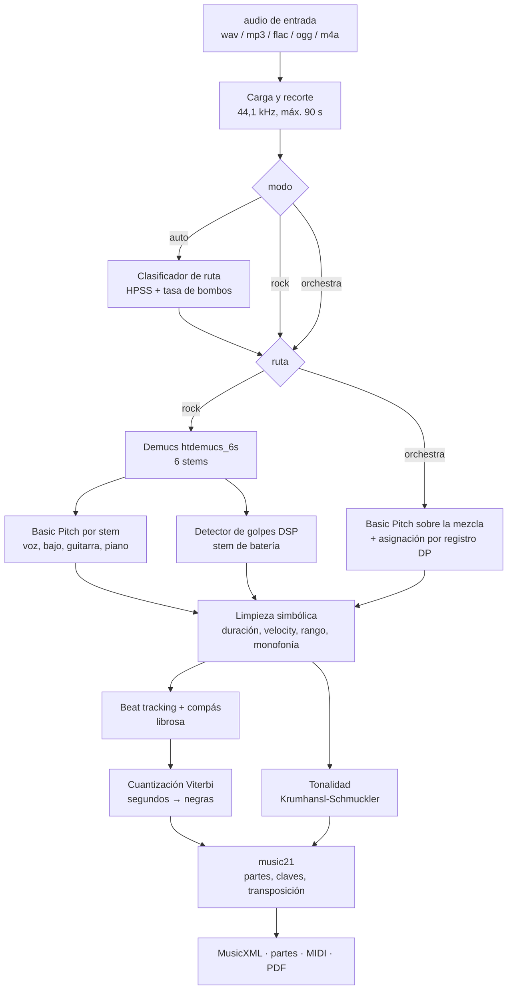
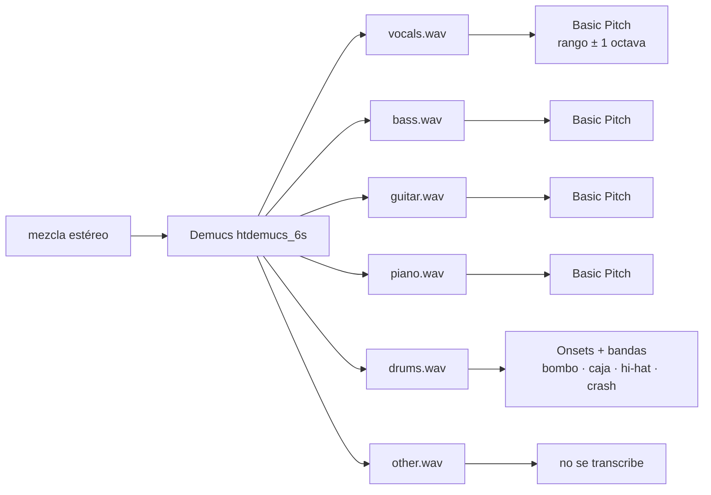

# Flujo de procesamiento del audio

Qué pasa con un audio desde que llega al worker hasta que salen la partitura y los MIDI. Todo vive en
`src/pipeline/` y se orquesta en `run.py` (`run()`), que usan igual la CLI, la API local y el worker
de SageMaker. La formulación matemática de cada paso está en [`matematicas.md`](matematicas.md).

- [Visión general](#visión-general)
- [Etapas](#etapas)
- [Ruta rock](#ruta-rock-cascada)
- [Ruta orquesta](#ruta-orquesta-end-to-end)
- [Engraving común](#engraving-común)
- [Exportación y manifiesto](#exportación-y-manifiesto)
- [Progreso, advertencias y errores](#progreso-advertencias-y-errores)
- [Salidas en disco](#salidas-en-disco)
- [Limitaciones conocidas](#limitaciones-conocidas)

---

## Visión general



El orden de las etapas y sus nombres (`STAGES` en `src/contract/jobs.py`) son:

| Etapa           | Qué incluye                                                              | Se salta en…       |
| --------------- | ------------------------------------------------------------------------ | ------------------ |
| `separation`    | Demucs                                                                   | ruta orquesta      |
| `transcription` | Basic Pitch por stem o sobre la mezcla, detector de batería              | —                  |
| `engraving`     | limpieza, beat tracking, tonalidad, cuantización, construcción en music21 | —                  |
| `export`        | MusicXML, partes, MIDI, PDF                                              | —                  |

El tiempo de cada etapa se acumula en `stages` (segundos) y se devuelve al cliente.

---

## Etapas

### 0. Carga (`audio.py`, `run.run`)

1. `librosa.load` decodifica cualquier formato que lea ffmpeg/libsndfile, a 44 100 Hz y con los canales
   originales (`(canales, muestras)`, `float32`).
2. Se carga como máximo `max_duration + 1` s; si el audio supera `max_duration` (90 s) se recorta y se
   añade una advertencia.
3. Se guarda como `input.wav` en la carpeta de trabajo (para Basic Pitch en la ruta orquesta); se borra
   al final.

### 1. Elección de ruta (solo `mode=auto`)

`routing.classify` calcula sobre el mix mono a 22 050 Hz la **fracción percusiva** (HPSS) y la **tasa
de golpes graves**, y las combina con una logística $P(\text{rock}) = \sigma(-3 + 10\rho + 0{,}8\kappa)$.
La decisión y sus rasgos se devuelven en `route` y se añade una advertencia ("Modo automático: se eligió
la ruta «…» (p(rock) = …)"). Después, `instruments_for_route` descarta los instrumentos pedidos que no
existen en esa ruta y, si no queda ninguno, usa los de por defecto.

Con `mode = rock` u `orchestra` no hay clasificación (`route = null`).

---

## Ruta rock (cascada)



1. **Separación** (`separation.separate`): normaliza, aplica HTDemucs con segmentos solapados un 25 % y
   un desplazamiento aleatorio, y escribe un WAV por stem (`stems/vocals.wav`, `drums.wav`, `bass.wav`,
   `guitar.wav`, `piano.wav`, `other.wav`). Usa GPU si hay (`A2S_DEVICE`).
2. **Transcripción por instrumento** (`transcription.transcribe_stem`). Cada instrumento del catálogo
   declara en qué stem va (`Instrument.stem`):
   - melódicos (voz, guitarra, bajo, piano): Basic Pitch sobre su stem, con el rango del instrumento
     ampliado una octava a cada lado;
   - batería: `drums.transcribe` (§4 de matemáticas).
3. Si el stem de un instrumento pedido no existe, se añade una advertencia y se omite.

Los instrumentos por defecto son voz, guitarra, bajo, piano y batería (`DEFAULTS` en
`contract/instruments.py`).

---

## Ruta orquesta (end-to-end)

Demucs no tiene stems orquestales, así que **no hay etapa `separation`**:

1. `transcribe_mix` ejecuta Basic Pitch sobre toda la mezcla, restringido a
   $[\min_i l_i, \max_i h_i]$ de los instrumentos pedidos.
2. `assign_notes` reparte las notas entre los instrumentos por registro y tesitura, acorde por acorde,
   con una programación dinámica monótona (§5 de matemáticas).
3. Se añade siempre una advertencia: los instrumentos se asignan por rango, no por timbre.

Backend seleccionable con `A2S_MULTI_BACKEND`:

| Valor                         | Estado                                                                           |
| ----------------------------- | -------------------------------------------------------------------------------- |
| `basic-pitch-assign` (defecto) | implementado                                                                    |
| `muscriptor`, `yourmt3`, `mt3` | reservados: lanzan `BackendUnavailable` hasta verificar licencia y VRAM         |

---

## Engraving común

Recibe `tracks = {instrumento: [Note en segundos]}` y produce una partitura. Corresponde a
`run.engrave`; todo ocurre dentro de la etapa `engraving`.

| Paso | Módulo        | Qué hace                                                                                                        |
| ---- | ------------- | --------------------------------------------------------------------------------------------------------------- |
| 1    | `symbolic.py` | `prepare`: quita notas cortas/débiles, fusiona fragmentos, pliega octavas al rango y reduce a una voz si es monofónico |
| 2    | —             | Avisa de los instrumentos sin notas ("no se detectaron notas") y los descarta                                   |
| 3    | `rhythm.py`   | `track_beats` sobre el mix mono a 22 050 Hz → rejilla de pulsos, tempo plegado a 60–180 BPM, compás 3/4 o 4/4   |
| 4    | `key.py`      | `estimate_key` con las notas afinadas (sin batería)                                                              |
| 5    | `rhythm.py`   | `quantize_tracks`: todas las pistas contra la misma rejilla y origen de compás; Viterbi por pulso               |
| 6    | `symbolic.py` | Vuelve a reducir a monofonía tras cuantizar (la cuantización puede crear solapes)                                |
| 7    | `score.py`    | `build_score`: una parte por instrumento en altura escrita, claves, ligaduras, gran pentagrama, percusión       |

Detalles de la partitura:

- **Orden de la partitura:** el del catálogo (maderas, metales, percusión, teclados, voces, cuerdas),
  `catalog.score_order`.
- **Transpositores:** clarinete, saxo alto, corno, trompeta y las octavas de guitarra/bajo/contrabajo
  se escriben transpuestos y con su propia armadura; la parte lleva `atSoundingPitch = False`.
- **Longitud:** todas las partes se rellenan con silencios hasta compases completos.
- **Tempo:** `round(grid.tempo)`; solo la primera parte lleva la marca de metrónomo.

---

## Exportación y manifiesto

`run.export_all` (etapa `export`):

| Archivo                           | Contenido                                                                              |
| --------------------------------- | -------------------------------------------------------------------------------------- |
| `score.musicxml`                  | partitura completa                                                                     |
| `parts/<instrumento>.musicxml`    | parte individual para el intérprete (piano/arpa con sus dos pentagramas)               |
| `score.mid`                       | todos los instrumentos, cuantizado al tempo de la partitura                            |
| `midi/<instrumento>.mid`          | un instrumento, cuantizado (suena sincronizado con el cursor de la partitura)         |
| `midi/raw/<instrumento>.mid`      | transcripción cruda en segundos, alineada con el audio                                 |
| `score.pdf`                       | MuseScore por línea de comandos; opcional, `null` si falta MuseScore o falla           |
| `stems/<stem>.wav`                | solo ruta rock                                                                         |
| `manifest.json`                   | resultado del job (el que guarda el worker junto a los archivos)                       |

`run()` devuelve el manifiesto con las rutas **relativas** a la carpeta de salida; el worker las
convierte en claves de S3 (`results/<jobId>/…`) y la API en URLs prefirmadas. Forma:

```jsonc
{
  "resolvedMode": "rock",
  "instruments": ["vocals", "guitar", "bass", "piano", "drums"],
  "stages": { "separation": 41.2, "transcription": 12.8, "engraving": 3.1, "export": 9.6 },
  "warnings": ["Partitura aproximada: …"],
  "route": { "probabilityRock": 0.93, "features": { "percussive_share": 0.41, "kick_rate": 1.7 } },
  "result": {
    "durationSec": 20.0, "tempo": 120.0, "timeSignature": "4/4", "key": "A minor",
    "stems": [{ "name": "vocals", "label": "Voz", "key": "stems/vocals.wav" }],
    "midi":  [{ "instrument": "bass", "name": "Bajo eléctrico", "key": "midi/bass.mid", "notes": 64 }],
    "midiFull": "score.mid",
    "score": { "musicxml": "score.musicxml", "pdf": "score.pdf" },
    "parts": [{ "instrument": "bass", "name": "Bajo eléctrico", "key": "parts/bass.musicxml" }]
  }
}
```

(Los valores del ejemplo son ilustrativos.)

---

## Progreso, advertencias y errores

- **Progreso:** `Stopwatch.stage(nombre)` notifica `on_stage(nombre, tiempos_acumulados)` al **empezar**
  cada etapa. El worker lo escribe en DynamoDB (`stage`, `stages`), que es lo que ve la interfaz al
  consultar el job. La escritura es _best effort_: si falla, el job continúa.
- **Advertencias** (`warnings`): siempre la de "partitura aproximada"; además recorte de duración,
  modo automático, ruta orquestal por registro, instrumentos sin stem o sin notas, y PDF no disponible.
- **Errores:** una excepción en el pipeline marca el job `FAILED` con
  `"El procesamiento falló: <mensaje>"` (máx. 500 caracteres) y se relanza; SageMaker la recoge y
  notifica al topic de error.

---

## Salidas en disco

La CLI escribe en `outputs/<nombre>/` exactamente el mismo árbol que el worker sube a S3:

```text
outputs/<nombre>/
├── stems/            # solo rock
├── midi/             # cuantizado; midi/raw/ alineado con el audio
├── parts/
├── score.musicxml
├── score.mid
├── score.pdf
└── manifest.json
```

---

## Limitaciones conocidas

Son hallazgos de la Fase 0 sobre audio real (ver "Open items" en `CLAUDE.md`):

- `routing.py` etiqueta como rock los tríos clásicos (la tasa de graves cuenta notas de piano/cello).
- La asignación por registro falla con piano (F1 multi-instrumento 0,37 sobre TRIOS).
- No se descartan los stems casi silenciosos.
- El detector de batería no distingue el ride.
- La partitura es aproximada por diseño: sirve para tocar y estudiar, no es una edición editorial.
- Basic Pitch no usa los _pitch bends_ ni distingue instrumentos; la voz sale como melodía de un solo instrumento.
